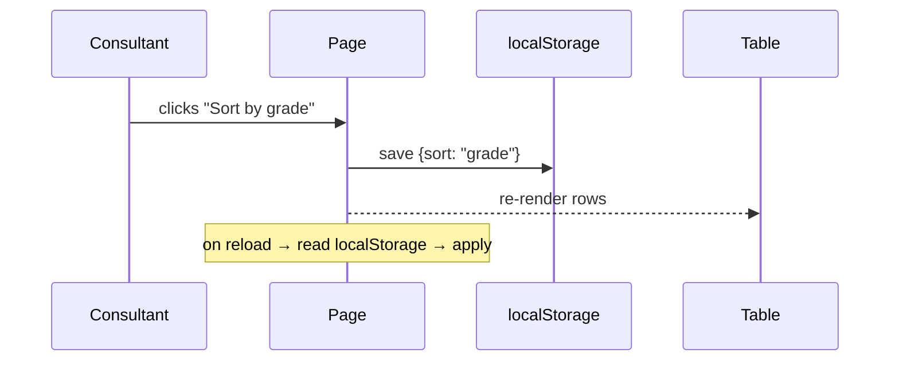

# Frontend Spec Template

How to describe a front-end change so an AI agent implements it right the first
time — without sketching anything. Copy one **block** per feature area; keep
every heading.

The core idea: **words for behaviour, a named reference plus numbers for look,
a text diagram for flow.** The agent is blind — it reads code, not pixels — so a
look must arrive as something readable: the closest existing view ("like the card
in `resources/views/.../x.blade.php`, but full-width with an 8px gap"),
decomposed into structure, chrome, spacing, text and states, with numbers for
everything you would otherwise draw. A picture alone loses behaviour, spacing
and breakpoints; a picture with arrows loses the arrows (the model reads them as
vague proximity, not a sequence). Layer reference + structure + numbers in one
block and the ambiguity is gone. An image stays the last resort — only for pure
taste with no textual referent.

---

## 1. The block (copy this)

```markdown
## <Feature area — short name>

Goal: <one sentence, the user-visible outcome>

Where:
- UI:       resources/views/<...>.blade.php   (the <section>/partial that renders it)
- Style:    resources/css/features/<...>.css  (the .class rules)
- Behavior: resources/js/features/<...>.js    (the handler / init)
  (write "N/A" for any layer the change does not touch — do not leave it blank)

Structure: <boxes in order + layout words (row/column/gap/align/wrap); per-box
  chrome (border/radius/background/shadow); spacing in numbers; exact strings;
  states (default/hover/focus/empty); responsive (breakpoint + what stacks or
  hides below it). Write "N/A" only when no pixel on screen changes.>

Now → Should:
- Now:    <what it does today — quote the class, line, or wording>
- Should: <what it must do instead — concrete, measurable>

Visual target: <closest in-repo view or named pattern — "like X, but …";
  screenshot only when nothing in-repo matches and taste itself is the spec>

Flow: <only if there is a sequence — a Mermaid or ASCII arrow line, see §4>

Out of scope: <what NOT to touch — e.g. "don't change tenant theming">

Acceptance: <page + which data row you'll check it on in the browser>
```

---

## 2. Which medium for which ambiguity

| What is fuzzy                | Cheapest medium              | Why                                                              |
|------------------------------|------------------------------|------------------------------------------------------------------|
| What it should **look** like | Named reference + numbers    | An in-repo view carries its exact CSS; "like X, but …" transfers the look with zero ambiguity |
| How parts **connect / flow** | Diagram, but as **text**     | Arrows in a PNG are read lossily; text arrows are exact + editable |
| What it should **do**, where | Markdown + **anchors**       | Behaviour, state and naming are where words beat pixels          |

Rule of thumb: **if you'd draw an arrow, write it as text (Mermaid). If you'd
say "like this", name the closest existing view first ("like the card in
`resources/views/.../x.blade.php`, but …") and number the differences. If you'd
explain a rule, write prose + a `file:class` anchor.** Attach a picture only
when no reference exists and taste itself is the spec — and still fill the
block, because the image cannot carry spacing, breakpoints or behaviour.

---

## 3. Worked examples (from this repo)

### Example A — layout / spacing (a CSS change)

```markdown
## Exam runner spacing

Goal: question cards and their options stop feeling cramped on mobile.

Where:
- UI:       N/A (same markup)
- Style:    resources/css/features/exams.css  (.exam-question, .exam-option)
- Behavior: N/A

Structure: column of cards; option blocks separated by a gap;
  single column below 640px

Now → Should:
- Now:    .exam-question has 8px padding and .exam-option blocks touch (0 gap)
- Should: 16px card padding; 8px gap between options; below 640px options stack

Visual target: N/A — the numbers in Should are the whole spec, no picture needed

Out of scope: don't touch the timer, progress bar, or submit button

Acceptance: /student exam page, any in-progress attempt
```

### Example B — behaviour (a JS change)

```markdown
## Report-card sort memory

Goal: the consultant's chosen sort order survives a page reload.

Where:
- UI:       N/A
- Style:    N/A
- Behavior: resources/js/features/consultant-report-cards.js  (sort handler)

Structure: N/A (no pixel on screen changes)

Now → Should:
- Now:    sort resets to default on every reload
- Should: selected sort key is stored and re-applied on load

Visual target: N/A

Out of scope: don't change the sort dropdown's markup or options

Acceptance: consultant → student report card, click "grade" sort, reload, order holds
```

### Example C — a flow (when a sequence exists)

Use text, not a screenshot of boxes:

```markdown
Flow:

```

Or, one line of ASCII if the graph is trivial:

```text
click sort ──► persist key ──► re-render ──► on reload: read key ──► re-render
```

---

## 4. Rules

1. **Reference first.** Before describing from scratch, name the closest
   existing thing: an in-repo view ("like the card in
   `resources/views/.../x.blade.php`, but full-width"), else a known pattern
   ("a GitHub-style comment thread") pinned down with concrete properties.
   A reference the agent can read beats any picture you could attach.
2. **Name all three layers** (UI / Style / Behavior) or write `N/A`. This is the
   single highest-value habit — it stops the agent "improving" adjacent code.
3. **Fill Structure for anything that moves a pixel.** Boxes in order, layout
   words (row/column/gap/align/wrap), per-box chrome
   (border/radius/background/shadow), spacing in numbers, exact strings, states
   (default/hover/focus/empty), responsive (breakpoint + what stacks or hides).
   Describe relationships, not positions ("button at row end, center-aligned
   with the input" — never x/y coordinates; RTL flips absolutes anyway).
4. **Now → Should, never just "make it nicer".** "Cramped" is unanswerable;
   "8px → 16px padding, 0 → 8px gap" is fully answerable. Colors as tokens
   ("primary background"), never hex — tenant theming must survive.
5. **One section per area**, titled `## <area>` — this is exactly the shape
   the plan agent's brief expects, so a block drops straight into the pipeline.
6. **A picture is a last resort, not a spec.** It is only for pure taste with no
   textual referent — and even then it never carries exact spacing, hex colours,
   breakpoints or z-order; state those in `Should`.
7. **`Out of scope` is mandatory.** It bounds the blast radius.
8. **Anchors beat descriptions.** `resources/css/features/exams.css
   (.exam-question)` locates the change; "the question styling" does not.

---

## 5. Anti-patterns

- **A lone screenshot + "make it like this"** → the agent guesses behaviour,
  spacing, and which breakpoints. Name the closest in-repo reference *and* fill
  the block; attach an image only when nothing in-repo matches.
- **Arrows only inside a PNG** → read as proximity, not order. Redraw as Mermaid.
- **Pasting whole files as "context"** → no signal about what changes. Point at
  the one region.
- **Leaving scope open** → the agent touches things you didn't want moved.
- **"Should be responsive"** → say the breakpoint and what changes below it.
- **"Make it prettier / cleaner"** → unanswerable. Say what changes, in numbers
  (Now → Should).
- **Absolute positions ("button at x=320")** → describe relationships ("button at
  row end, center-aligned with the input"). The agent thinks in flex/grid.

---

## 6. How this plugs into the workflow

- **Fastest path:** run `/pipeline` with one `## <area>` block as your message
  (the orchestrator passes it to the plan agent verbatim). If nothing in-repo
  matches the look you want, drop a screenshot next to it and reference it from
  `Visual target:` — the block itself still carries the spec.
- **Batch path:** keep adding `## <area>` blocks with more `/pipeline` calls; the
  system pauses after planning so you can queue several, then run `/go`.
- The plan agent turns the block into anchors (code view, alternatives, diagram);
  the resolver deconflicts it against other plans; propose implements and tests.
  A well-filled block removes the rework round-trips.

---

## 7. React islands

The student dashboard (`resources/js/features/student-dashboard.js`) is the
reference island. When the change lives in one:

- **UI stays Blade-owned.** The island mounts into a container the server
  rendered (the `data-react-island` hooks in
  `resources/views/student/dashboard.blade.php`); do not move the page
  skeleton into React in one step.
- **Style is the token sheet.** Islands wear the same semantic classes as the
  Blade surface — their CSS resolves the `var(--c-…)` properties emitted by
  `partials/theme-vars.blade.php` — or a named role from
  `resources/js/react/tokens.js`. A literal colour or an inline style is a
  defect, and direction comes from the shell, not the island.
- **Behavior keeps the page-router contract verbatim:** the entry exports
  `default function init(region)`, may return a cleanup, and React roots are
  released through it (`resources/js/react/mount.js`). Landing/login and
  `public/demo` are out of scope; studio chrome never consumes tenant tokens.
- **Verification:** add a jsdom parity test under `tests/Js/` in the shape of
  `student-dashboard.react.test.mjs`, then run `npm run test:studio` and
  `npm run build`.

---

## 8. Your first spec (fill this in)

<!-- TODO(human): replace the placeholder below with your next real front-end ask -->

```markdown
## <name your next front-end change>

Goal:

Where:
- UI:
- Style:
- Behavior:

Structure:

Now → Should:
- Now:
- Should:

Visual target: (closest in-repo view, or N/A — screenshot only as last resort)

Flow:

Out of scope:

Acceptance:
```
