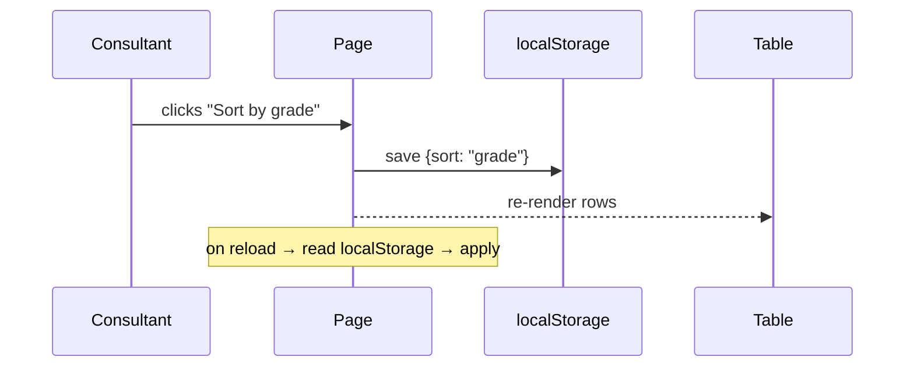

# Frontend Spec Template

How to describe a front-end change so an AI agent implements it right the first
time. Copy one **block** per feature area; keep every heading.

The core idea: **words for behaviour, an image for look, a text diagram for
flow.** A picture alone loses behaviour; words alone lose look; a picture with
arrows loses the arrows (the model reads them as vague proximity, not a
sequence). Layer all three in one block and the ambiguity is gone.

---

## 1. The block (copy this)

```markdown
## <Feature area — short name>

Goal: <one sentence, the user-visible outcome>

Where:
- UI:       resources/views/<...>.blade.php   (the <section>/partial that renders it)
- Style:    resources/css/features/<...>.css  (the .class rules)
- Behavior: resources/js/features/<...>.js    (the handler / init)
  (write "N/A" for any layer the change does not touch — do not leave it blank)

Now → Should:
- Now:    <what it does today — quote the class, line, or wording>
- Should: <what it must do instead — concrete, measurable>

Visual target: <screenshot, or "match the card in resources/views/.../x.blade.php">

Flow: <only if there is a sequence — a Mermaid or ASCII arrow line, see §4>

Out of scope: <what NOT to touch — e.g. "don't change tenant theming">

Acceptance: <page + which data row you'll check it on in the browser>
```

---

## 2. Which medium for which ambiguity

| What is fuzzy                | Cheapest medium              | Why                                                              |
|------------------------------|------------------------------|------------------------------------------------------------------|
| What it should **look** like | Screenshot / mock            | AI can't invent your taste; one image transfers the look         |
| How parts **connect / flow** | Diagram, but as **text**     | Arrows in a PNG are read lossily; text arrows are exact + editable |
| What it should **do**, where | Markdown + **anchors**       | Behaviour, state and naming are where words beat pixels          |

Rule of thumb: **if you'd draw an arrow, write it as text (Mermaid). If you'd
say "like this", attach a picture. If you'd explain a rule, write prose + a
`file:class` anchor.**

---

## 3. Worked examples (from this repo)

### Example A — layout / spacing (a CSS change)

```markdown
## Exam runner spacing

Goal: question cards and their options stop feeling cramped on mobile.

Where:
- UI:       N/A (same markup)
- Style:    resources/css/features/exams.css  (.exam-question, .exam-option)
- Behavior: N/A

Now → Should:
- Now:    .exam-question has 8px padding and .exam-option blocks touch (0 gap)
- Should: 16px card padding; 8px gap between options; below 640px options stack

Visual target: attached mock

Out of scope: don't touch the timer, progress bar, or submit button

Acceptance: /student exam page, any in-progress attempt
```

### Example B — behaviour (a JS change)

```markdown
## Report-card sort memory

Goal: the consultant's chosen sort order survives a page reload.

Where:
- UI:       N/A
- Style:    N/A
- Behavior: resources/js/features/consultant-report-cards.js  (sort handler)

Now → Should:
- Now:    sort resets to default on every reload
- Should: selected sort key is stored and re-applied on load

Visual target: N/A

Out of scope: don't change the sort dropdown's markup or options

Acceptance: consultant → student report card, click "grade" sort, reload, order holds
```

### Example C — a flow (when a sequence exists)

Use text, not a screenshot of boxes:

```markdown
Flow:

```

Or, one line of ASCII if the graph is trivial:

```text
click sort ──► persist key ──► re-render ──► on reload: read key ──► re-render
```

---

## 4. Rules

1. **Name all three layers** (UI / Style / Behavior) or write `N/A`. This is the
   single highest-value habit — it stops the agent "improving" adjacent code.
2. **Now → Should, never just "make it nicer".** "Cramped" is unanswerable;
   "8px → 16px padding, 0 → 8px gap" is fully answerable.
3. **One section per area**, titled `## <area>` — this is exactly the shape
   `.agent/PROMPT.md` expects, so a block drops straight into the pipeline.
4. **A picture is a reference, not a spec.** Never rely on an image to carry
   exact spacing, hex colours, or z-order — state those in `Should`.
5. **`Out of scope` is mandatory.** It bounds the blast radius.
6. **Anchors beat descriptions.** `resources/css/features/exams.css
   (.exam-question)` locates the change; "the question styling" does not.

---

## 5. Anti-patterns

- **A lone screenshot + "make it like this"** → the agent guesses behaviour,
  spacing, and which breakpoints. Attach the image *and* fill the block.
- **Arrows only inside a PNG** → read as proximity, not order. Redraw as Mermaid.
- **Pasting whole files as "context"** → no signal about what changes. Point at
  the one region.
- **Leaving scope open** → the agent touches things you didn't want moved.
- **"Should be responsive"** → say the breakpoint and what changes below it.

---

## 6. How this plugs into the workflow

- **Fastest path:** paste one `## <area>` block straight into `.agent/PROMPT.md`
  (its inbox holds one section per area). Drop your screenshot next to it and
  reference it from `Visual target:`.
- **Full path:** run `/pipeline` with the block as your message — the
  orchestrator captures it into `.agent/PROMPT.md` and spawns the plan stage.
- The plan agent turns the block into anchors; propose sketches the diff; punish
  implements and tests. A well-filled block removes the rework round-trips.

---

## 7. Your first spec (fill this in)

<!-- TODO(human): replace the placeholder below with your next real front-end ask -->

```markdown
## <name your next front-end change>

Goal:

Where:
- UI:
- Style:
- Behavior:

Now → Should:
- Now:
- Should:

Visual target:

Flow:

Out of scope:

Acceptance:
```
